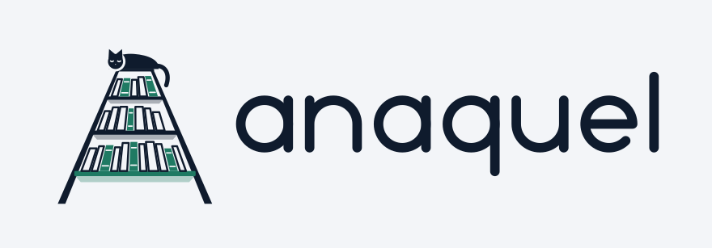
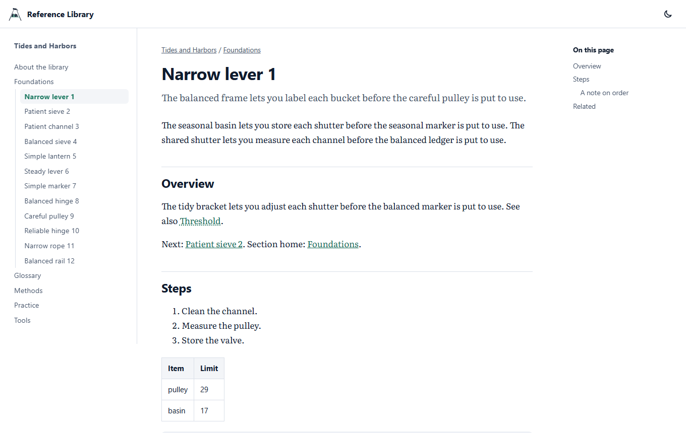

[English](README.md) | Español

<div align="center">

<picture>
  <source media="(prefers-color-scheme: dark)" srcset="assets/banner-dark.svg">
  
</picture>

# Anaquel

**Markdown de entrada. Un sitio de documentación estático, estricto y rápido de salida.**

[](https://github.com/saidcveltran/anaquel/actions/workflows/ci.yml)

[](LICENSE)
[](https://github.com/saidcveltran/anaquel/releases)


</div>

Anaquel es un motor de documentación escrito en Rust que convierte Markdown en un sitio estático que cualquier alojamiento web puede servir, sin IA en el producto. El programa corre en Windows y Linux; la integración continua lo compila y prueba en x86_64 y ARM64 (mira [Instalación](#instalación)).

> **Estado: desarrollo temprano; 0.2.1 es la última versión publicada y la 0.1.0 fue la primera.** El motor compila y comprueba una biblioteca, el servidor de vista previa funciona y una biblioteca de ejemplo de 271 páginas compila sin diagnósticos. No hay manual. Una biblioteca escrita para la 0.1 necesita un solo cambio para funcionar con la 0.2: poner `engine = "0.2"` en su `anaquel.toml`; la 0.2.1 no exige ningún cambio a una biblioteca 0.2. La 0.2.1 añade `anaquel studio`, el editor local. De la 0.2.1 se compararon las sumas SHA-256 de los cinco archivos con los descargados de la versión, `anaquel upgrade` se ejecutó en Windows x86_64 desde la 0.2.0 publicada hasta la 0.2.1 publicada (comprobación, instalación, una segunda comprobación que dice que está al día, vuelta atrás y rechazo de una versión que no está en el manifiesto), y el archivo de Windows x86_64 ejecutó `version` y `check --strict` sobre la biblioteca de ejemplo; los otros cuatro archivos no los ejecutó una persona, `anaquel studio` no se ejecutó desde el archivo publicado (una compilación de release del mismo commit lo arrancó, y respondió como debe a un puerto ocupado y a una carpeta sin biblioteca, y una compilación de depuración se probó en Chrome), las atestaciones de compilación no se verificaron y ninguno de los dos instaladores se ejecutó. De la 0.2.0 se compararon las sumas SHA-256 de los cinco archivos con los descargados de la versión, y `anaquel upgrade` se ejecutó en Windows x86_64 contra la versión real, desde una compilación candidata de la 0.2.0 hasta la 0.2.0 (comprobación, instalación, vuelta atrás y rechazo de una versión que no está en el manifiesto); el archivo de Linux estático (musl) se descomprimió y ejecutó en un contenedor Alpine 3.20 limpio en x86_64 (`version`, `new`, `check --strict`, `build --strict`, `relocate` con su simulacro, un movimiento real y un rechazo, y `upgrade --check` contra la versión real), y `upgrade` en sí se ejecutó allí desde una compilación 0.2.0-rc.1 hecha en Alpine hasta la 0.2.0 publicada, con vuelta atrás y rechazo de una versión desconocida; el archivo de Linux gnu x86_64 se ejecutó en un sistema Debian 13.7 en vivo dentro de una máquina de VirtualBox (sumas, `version`, `new`, `check --strict`, `build --strict`, `relocate` y `upgrade --check` contra la versión real), mientras que los archivos de Linux ARM64 y Windows ARM64 no los descargó ni ejecutó una persona, las atestaciones de compilación no se verificaron y ninguno de los dos instaladores se ejecutó. De la 0.1.1 se comprobaron con los archivos reales de la versión los dos archivos, sus sumas SHA-256 y sus atestaciones de compilación, y el archivo de Windows se descomprimió y ejecutó `version`, `new`, `check --strict` y `build`. El archivo de Linux lo descomprimió en Linux x86_64 un segundo probador y ejecutó esos mismos cuatro comandos y un `serve` de 10 minutos; allí se compararon las sumas, pero no se verificó la firma de la atestación. El instalador de shell se comprobó en Linux, en el modo que no toca tu `PATH`, solo con la 0.1.0; el instalador de PowerShell y el modo por defecto del instalador de shell no se comprobaron. No se ha probado ningún despliegue en un alojamiento web, ni en Cloudflare ni en otro; solo el servidor de vista previa local. Lee [Cuándo no usar Anaquel](#cuándo-no-usar-anaquel) antes de empezar.

<p align="center">
  <picture>
    <source media="(prefers-color-scheme: dark)" srcset="assets/screenshot-dark.png">
    
  </picture>
</p>

<h3 align="center">Construido con</h3>

<p align="center">
  
  
  
  
  
</p>

| Biblioteca | Versión | Para qué |
| --- | --- | --- |
| [`pulldown-cmark`](https://crates.io/crates/pulldown-cmark) | 0.13.6 | Leer CommonMark y GFM. |
| [`minijinja`](https://crates.io/crates/minijinja) | 3.1.0 | Las plantillas del tema. |
| [`blake3`](https://crates.io/crates/blake3) | 1.8.7 | Las huellas de los nombres de los recursos. |
| [`axum`](https://crates.io/crates/axum) y [`tokio`](https://crates.io/crates/tokio) | 0.8.9 y 1.54.1 | El servidor de vista previa. |
| [`notify`](https://crates.io/crates/notify) | 8.2.2 | Vigilar el origen para la vista previa. |
| [`clap`](https://crates.io/crates/clap) | 4.6.7 | La línea de comandos. |

Cada dependencia está fijada a una versión exacta. [THIRD-PARTY.md](THIRD-PARTY.md) las lista todas con su licencia.

## In English

**Anaquel** is a documentation engine written in Rust that turns Markdown into a static site that any web host can serve, with no AI in the product. It is early (version 0.1), has no release and no manual. The full English version is [README.md](README.md). The documentation of the project is in English; this file is its Spanish translation.

## Contenido

- [Qué hace](#qué-hace)
- [Para quién es](#para-quién-es)
- [Instalación](#instalación)
- [Ejemplo de cinco minutos](#ejemplo-de-cinco-minutos)
- [Comandos](#comandos)
- [Comparación](#comparación)
- [Cuándo no usar Anaquel](#cuándo-no-usar-anaquel)
- [Cómo encaja](#cómo-encaja)
- [Desarrollo y pruebas](#desarrollo-y-pruebas)
- [Preguntas frecuentes](#preguntas-frecuentes)
- [Cambios](#cambios)
- [Licencia](#licencia)

## Qué hace

Un sitio es una **Biblioteca** (Library) hecha de **Tomos** (Volumes, los libros). Cada tomo tiene secciones y páginas. Los **Estantes** (Shelves) agrupan tomos bajo una dirección común; están disponibles desde la 0.2.0 (mira `examples/multi-shelf`).

| Función | Etapa | Detalle |
| --- | --- | --- |
| Markdown CommonMark y GFM con front matter YAML | Disponible (0.1) | Tablas, listas de tareas, tachado, notas al pie |
| Enlaces `[[término]]` a una entrada del glosario del mismo tomo | Disponible (0.1) | Las entradas son los encabezados `###` de `terms.md` o `glossary.md` |
| El build se detiene ante enlaces rotos, anclas rotas, URL duplicadas y términos desconocidos | Disponible (0.1) | Los diagnósticos tienen códigos estables `AQ####`; `--strict` falla también ante advertencias |
| Una página que desaparece sin alias es un error | Disponible (0.1) | Los alias se vuelven páginas de redirección y un archivo `_redirects` (el formato que lee Cloudflare; en otros servidores las reglas se copian a mano) |
| Se rechaza el HTML en bruto; solo pasan enlaces `http`, `https` y `mailto` | Disponible (0.1) | Ver [SECURITY.md](SECURITY.md) |
| Content-Security-Policy estricta, sin scripts ni estilos en línea | Disponible (0.1) | Se escribe en `_headers` (el formato que lee Cloudflare; en otros servidores las reglas se copian a mano); el servidor de vista previa aplica las mismas reglas |
| Búsqueda de texto completo | Disponible (0.1) | Con el programa externo [Pagefind](https://pagefind.app); ver [la decisión](docs/decisions/0001-search.md) |
| Vista previa local que recompila y recarga | Disponible (0.1) | `anaquel serve`, solo en `127.0.0.1` |
| Tema `folio` con esquemas claro y oscuro y la fuente Literata incluida | Disponible (0.1) | Sin npm ni framework; el movimiento respeta `prefers-reduced-motion` |
| Directivas: aviso, detalles, pestañas, tarjetas, pasos, columnas, incrustado | Disponible (0.1) | Una página cada una en [`examples/directives`](examples/directives); el conjunto es cerrado |
| Resaltado de sintaxis del código con valla, en ambos esquemas | Disponible (0.1) | Solo clases, sin estilos en línea; Rust, Python, JavaScript, JSON, YAML, shell, HTML, CSS, SQL, C, C++, Go, Java y más; los demás quedan en texto plano (aún sin TOML, TypeScript ni PowerShell) |
| Fuzzing de los analizadores | Disponible (0.1) | [`fuzz/`](fuzz): objetivos de libFuzzer que corren 10 minutos en CI solo en Linux; en todos los sistemas una prueba de humo reproduce el corpus; ver [`fuzz/README.md`](fuzz/README.md) |
| Estantes, `llms.txt`, tomos traducidos con enlaces `hreflang`, textos del tema en inglés y español | Disponible (0.2) | Mira [`examples/multi-shelf`](examples/multi-shelf) y [`examples/bilingual`](examples/bilingual); los demás idiomas del tema se leen en inglés |
| `anaquel upgrade` (`--check`, `--version`, `--allow-downgrade`, `--rollback`) | Disponible (0.2); no desde la 0.1.1, que no tiene `upgrade` | Descarga la información firmada del release desde los releases de GitHub del proyecto por HTTPS, verifica su firma minisign con las dos claves incluidas en el programa, y entonces elige un release y rechaza actualizaciones caducadas, repetidas, retiradas, que bajan de versión o de otra dirección. Comprueba el tamaño y el SHA-256 del único archivo, ejecuta el programa nuevo para ver que arranca y dice la versión prometida, y lo pone en su lugar guardando una versión anterior (`--rollback` vuelve a ella). No reemplaza un programa que pertenezca a Scoop, winget o al gestor de paquetes del sistema. El release 0.2.0 lleva un manifiesto firmado con la clave activa, y en Windows x86_64 se ejecutaron a mano la comprobación, la instalación y la vuelta atrás contra él, desde una compilación candidata de la 0.2.0; una versión que no está en el manifiesto se rechaza. En Linux estático (Alpine, x86_64) también se ejecutaron a mano la comprobación, la instalación, la vuelta atrás y el rechazo contra el release real; la instalación en Linux gnu y todo en ARM solo se ejecutó por CI contra una red simulada. El release 0.2.1 lleva un manifiesto con los dos releases, firmado con la clave activa; la única actualización entre dos releases publicados se ejecutó a mano en Windows x86_64, de la 0.2.0 a la 0.2.1 (comprobación, instalación, vuelta atrás, al día, rechazo de una versión desconocida). La herramienta `anaquel-sign` del mantenedor escribe y firma el manifiesto |
| `anaquel relocate FROM TO` (alias `mv`, `--dry-run`) | Disponible (0.2) | Mueve una página o, mediante su `_index.md`, una carpeta; añade la dirección antigua a los `aliases` de la página, reescribe los enlaces en línea y las definiciones de referencia que apuntan a ella, y solo escribe cuando una compilación completa del resultado no da ningún error. Cada archivo espera con un nombre temporal hasta que todos están en su sitio, y una escritura fallida se deshace. Probado en Linux y Windows en CI. Límites: una caída a mitad de la escritura no se deshace y puede dejar archivos `.anaquel-held-NNNNNN`; una página con una tarjeta de `href` relativo, una lista `aliases` con comentario o un archivo con finales de línea mezclados detiene el movimiento; los archivos estáticos no dejan redirección; ver [la decisión](docs/decisions/0002-relocate-and-aliases.md) |
| Documentación versionada | Prevista (M2) | Sin empezar |
| Versiones para Linux estático (musl), Linux ARM64 y Windows ARM64 | Disponible (0.2) | Las versiones 0.2.0 y 0.2.1 traen archivos para los cinco destinos. La integración continua ejecuta las pruebas y compila y descomprime el archivo de versión de los cinco, con ejecutores nativos para los dos de ARM, y comprueba que la versión estática no tiene dependencias dinámicas. La 0.1.1 solo trae Windows x86_64 y Linux x86_64. De la 0.2.0 se ejecutó el archivo de Windows x86_64 (mediante `upgrade`) el de Linux estático en un contenedor Alpine x86_64 y el de Linux gnu x86_64 en un sistema Debian 13.7 en vivo; los otros dos (ARM64) no se descargaron ni se ejecutaron. De la 0.2.1 solo se ejecutó el archivo de Windows x86_64 |
| `anaquel studio [ROOT] [--port N]`: editar páginas en el navegador del mismo ordenador, con vista previa en vivo | Disponible (0.2.1), fase 1; la 0.2.0 no lo tiene | Fase 1 del panel web, [el diseño](docs/decisions/0006-studio-phase-one.md): lista de páginas, cuadro de texto, vista previa construida por el mismo código que el sitio, validación y un guardado que se niega a pisar una página que otro programa cambió. Escucha solo en `127.0.0.1`, detrás de una clave aleatoria, y comprueba `Host` y `Origin` en cada petición. Tiene pruebas automáticas en Linux y Windows en la CI y se probó una vez a mano en Chrome sobre Windows (lo que halló dos defectos, ya corregidos); no se ha probado en otro navegador ni sistema, y el studio del archivo publicado no lo ejecutó una persona (una compilación de release del mismo commit lo arrancó y rechazó un puerto ocupado y una carpeta sin biblioteca). Límites: un usuario, sin cuentas, sin historial, sin solicitudes de cambio y sin publicación; solo edita páginas existentes (no las crea, renombra ni borra); los vídeos incrustados se ven sin scripts |
| Un panel web para varias personas, alojado por uno mismo en un VPS o cualquier servidor | Prevista, después de usar la fase 1 | Cuentas, roles y solicitudes de cambio no están diseñados al detalle y no existe nada de ello |

## Para quién es

- **Autores de un manual** que quieren que el build falle ante un enlace roto en vez de publicarlo.
- **Quien aloja un sitio por su cuenta**, en un VPS, un alojamiento estático o Cloudflare, y quiere las cabeceras y las redirecciones generadas con el sitio. Los archivos usan el formato `_headers` y `_redirects` de Cloudflare; en otro servidor se copian las mismas reglas a mano.
- **Quien contribuye** y prefiere un workspace de Rust pequeño, con lints estrictos y sin uso oculto de la red.

## Instalación

Descarga el archivo de tu sistema desde la [página de versiones](https://github.com/saidcveltran/anaquel/releases), compáralo con las sumas SHA-256 publicadas junto a él, descomprímelo y ejecuta `anaquel version`. O compila desde el código: necesitas Rust 1.99 o posterior ([rustup](https://rustup.rs)) y Git.

```text
git clone https://github.com/saidcveltran/anaquel.git
cd anaquel
cargo build --release -p anaquel
```

| Sistema | Ejecutar |
| --- | --- |
| Windows (PowerShell) | `.\target\release\anaquel.exe version` |
| Linux | `./target/release/anaquel version` |

La búsqueda necesita el programa `pagefind` junto a `anaquel` o en el `PATH` (o la variable `ANAQUEL_PAGEFIND` con su ruta). Sin él, el sitio se compila igual, sin cuadro de búsqueda. `anaquel doctor` te dice en qué caso estás.

Las versiones traen sumas SHA-256. No están firmadas por Windows, así que SmartScreen avisará; es lo esperado. La 0.2.0 y la 0.2.1 traen archivos para Windows x86_64, Windows ARM64, Linux x86_64, Linux ARM64 y un Linux x86_64 estático (musl, sin bibliotecas dinámicas); la 0.1.1 solo para Windows x86_64 y Linux x86_64. macOS no está soportado: nadie ejecuta Anaquel ahí, y las versiones posteriores a la 0.1.0 no traen archivo para macOS (la 0.1.0 conserva dos que ya no se mantienen), así que el instalador de una versión posterior falla en un Mac porque no encuentra archivo para ese sistema; es lo esperado, no un error.

## Ejemplo de cinco minutos

```text
anaquel new my-docs --title "My docs"
anaquel check my-docs --strict
anaquel serve my-docs
anaquel build my-docs
```

`serve` imprime `http://127.0.0.1:1111/`; edita un archivo de `my-docs/volumes/guide/` y la página se recarga. `build` escribe el sitio en `my-docs/dist`, listo para subir a un alojamiento estático. La integración continua ejecuta `new`, `check` y `build` en Linux y Windows en cada cambio, así que estos comandos están probados. Aún no se ha probado subir el resultado a un alojamiento y no hay guía para cada uno.

## Comandos

`anaquel --help` imprime el uso completo. El código de salida 1 significa que se hallaron problemas en el contenido; 2, que el propio comando falló.

| Comando | Qué hace |
| --- | --- |
| `new CARPETA [--title T]` | Crea una biblioteca pequeña; rechaza una carpeta que no esté vacía |
| `check [RAÍZ] [--strict]` | Lee la biblioteca e informa de los diagnósticos, no escribe nada |
| `build [RAÍZ] [--out DIR] [--no-search] [--strict]` | Escribe el sitio estático |
| `serve [RAÍZ] [--port N] [--search]` | Vista previa en `127.0.0.1` que recompila y recarga al cambiar |
| `studio [RAÍZ] [--port N]` | Edita páginas en el navegador del mismo ordenador, con vista previa en vivo; imprime una dirección con una clave aleatoria (desde la 0.2.1) |
| `doctor` | Informa de las herramientas que Anaquel encuentra en este equipo |
| `upgrade [--check] [--version X.Y.Z [--allow-downgrade]] [--rollback]` | Reemplaza este programa por un release firmado más nuevo, o vuelve al que reemplazó; es el único comando que usa la red (desde la 0.2) |
| `version` | Imprime la versión |

## Comparación

Hechos tal como los conozco; comprueba cada proyecto antes de decidir.

| | Anaquel | [Hugo](https://gohugo.io) | [mdBook](https://rust-lang.github.io/mdBook/) | [Starlight](https://starlight.astro.build) | [GitBook](https://www.gitbook.com) |
| --- | --- | --- | --- | --- | --- |
| Tipo | Programa que ejecutas | Programa que ejecutas | Programa que ejecutas | Framework que ejecutas | Servicio alojado |
| Escrito en | Rust | Go | Rust | JavaScript (Astro) | No aplica |
| Necesita Node y npm | No | No | No | Sí | No |
| Licencia | Apache-2.0 | Apache-2.0 | MPL-2.0 | MIT | Servicio propietario |
| El build se detiene ante un enlace roto | Sí | No por defecto | Necesita una herramienta extra | Necesita un complemento extra | No aplica |
| Madurez | 0.1, un mantenedor | Años de versiones | Años de versiones | Años de versiones | Producto comercial |

La última fila es la que cuenta hoy.

## Cuándo no usar Anaquel

- Necesitas algo que funcione hoy en producción: Anaquel está en la 0.1 y no tiene manual.
- Dependes de un ecosistema grande de temas, complementos e importadores: no existe, y una sola persona mantiene el proyecto.
- Necesitas documentación versionada o una referencia OpenAPI: están previstas, no construidas. Varios idiomas funcionan desde la 0.2.
- Quieres búsqueda sin instalar otro programa: Pagefind es externo.
- Necesitas una interfaz en un idioma distinto del inglés: los textos del tema están solo en inglés por ahora.

## Cómo encaja

El build es una cadena: ingest, catalog, compose, render, emit, index. Cada etapa es un crate.

| Crate | Qué contiene |
| --- | --- |
| `anaquel` | La línea de comandos |
| `anaquel-schema` | Los esquemas de configuración y de front matter |
| `anaquel-diagnostics` | Los códigos `AQ####` y sus mensajes |
| `anaquel-directive` | La sintaxis de bloques `:::` |
| `anaquel-catalog` | El árbol de tomos y páginas, URL, enlaces, términos y el registro de URL perdidas |
| `anaquel-compose` | De Markdown a HTML seguro |
| `anaquel-theme`, `anaquel-render` | El tema `folio` y las plantillas de página |
| `anaquel-assets`, `anaquel-emit` | Recursos con huella, `_headers`, `_redirects`, `sitemap.xml`, `llms.txt`, 404 |
| `anaquel-search` | El puerto hacia Pagefind |
| `anaquel-pipeline` | Las etapas en orden |
| `anaquel-update` | El núcleo de confianza de `upgrade`: firma, elección de versión, huella de la descarga (sin red) |
| `anaquel-upgrade` | El trabajo de `upgrade`: el cliente de descarga, la lectura del archivo del release, la prueba del programa, el cambio y la vuelta atrás |
| `anaquel-sign` | La herramienta del mantenedor que crea las claves de firma y firma el manifiesto (no se distribuye) |
| `anaquel-preview` | El servidor de vista previa |

## Desarrollo y pruebas

```text
cargo fmt --all -- --check
cargo clippy --workspace --all-targets -- -D warnings
cargo test --workspace
cargo run -p anaquel -- check examples/reference-library --strict
python -I tools/check_images.py
```

El código `unsafe` está prohibido, la documentación que falta es un error y clippy corre con `pedantic`. `examples/reference-library` es una biblioteca inventada de 271 páginas que sirve para probar el motor. Ver [CONTRIBUTING.md](CONTRIBUTING.md).

## Preguntas frecuentes

**¿Está listo para usar?** No. Es la versión 0.1, la primera publicada. Compila y sus pruebas pasan en CI en tres sistemas.

**¿Usa IA?** No. No hay IA en el producto, ni en el build, ni en el sitio que escribe.

**¿Llama a algún servidor?** No. El servidor de vista previa escucha solo en `127.0.0.1` y el sitio compilado no carga nada de fuera de su propio host.

**¿Dónde está el manual?** Aún no está escrito. Este README, `anaquel --help` y la biblioteca de ejemplo son todo lo que hay.

## Cambios

Ver [CHANGELOG.md](CHANGELOG.md). Cada cambio queda anotado con sus límites conocidos.

## Licencia

Apache License 2.0: ver [LICENSE](LICENSE) y [NOTICE](NOTICE). Software de terceros: [THIRD-PARTY.md](THIRD-PARTY.md). El nombre y el logotipo no están cubiertos por la licencia: ver [TRADEMARKS.md](TRADEMARKS.md).

Informes de seguridad: [SECURITY.md](SECURITY.md). Cómo participar: [CONTRIBUTING.md](CONTRIBUTING.md) y el [Código de conducta](CODE_OF_CONDUCT.md).
