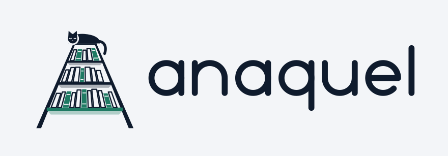
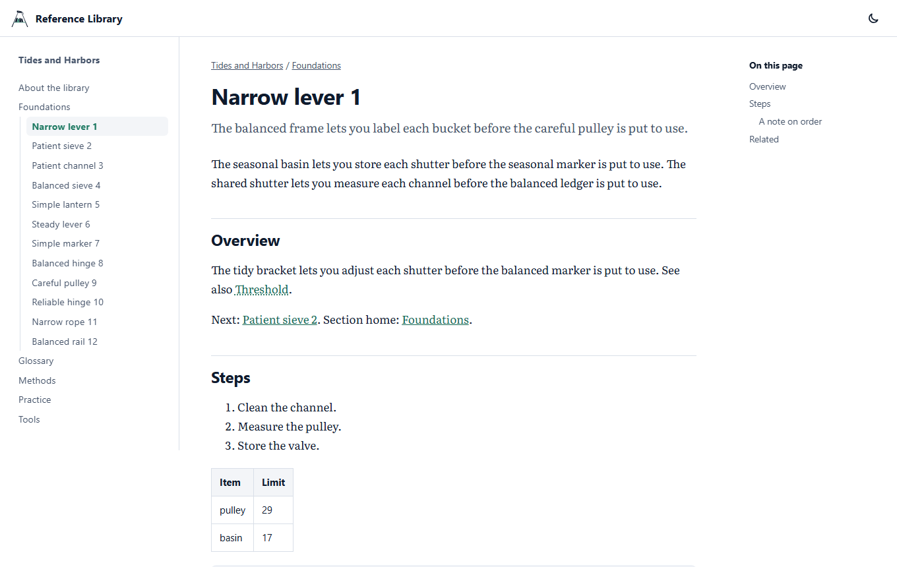

English | [Español](README.es.md)

<div align="center">

<picture>
  <source media="(prefers-color-scheme: dark)" srcset="assets/banner-dark.svg">
  
</picture>

# Anaquel

**Markdown in. A strict, fast, static documentation site out.**

[](https://github.com/saidcveltran/anaquel/actions/workflows/ci.yml)

[](LICENSE)
[](https://github.com/saidcveltran/anaquel/releases)


</div>

Anaquel is a documentation engine written in Rust that turns Markdown into a static site for Cloudflare Workers, with no AI in the product.

> **Status: early development; 0.1.1 is the latest release and 0.1.0 was the first.** The engine builds and checks a library, the preview server works, and a sample library of 271 pages builds with no diagnostics. There is no manual. For 0.1.1, the two archives, their SHA-256 sums and their build attestations were checked against the real release files, and the Windows archive was unpacked and ran `version`, `new`, `check --strict` and `build`. The Linux archive was unpacked on Linux x86_64 by a second tester and ran the same four commands and a 10-minute `serve`; there the sums were compared, but the attestation signature was not verified. The shell installer was checked on Linux in its mode that leaves your `PATH` alone for 0.1.0 only; the PowerShell installer and the default mode of the shell installer were not checked. No deployment to Cloudflare has been tested. Read [When not to use Anaquel](#when-not-to-use-anaquel) before you start.

<p align="center">
  <picture>
    <source media="(prefers-color-scheme: dark)" srcset="assets/screenshot-dark.png">
    
  </picture>
</p>

<h3 align="center">Built with</h3>

<p align="center">
  
  
  
  
  
</p>

| Library | Version | Used for |
| --- | --- | --- |
| [`pulldown-cmark`](https://crates.io/crates/pulldown-cmark) | 0.13.6 | Reading CommonMark and GFM. |
| [`minijinja`](https://crates.io/crates/minijinja) | 3.1.0 | The theme templates. |
| [`blake3`](https://crates.io/crates/blake3) | 1.8.7 | Fingerprints of the asset file names. |
| [`axum`](https://crates.io/crates/axum) and [`tokio`](https://crates.io/crates/tokio) | 0.8.9 and 1.54.1 | The preview server. |
| [`notify`](https://crates.io/crates/notify) | 8.2.2 | Watching the source for the preview. |
| [`clap`](https://crates.io/crates/clap) | 4.6.7 | The command line. |

Every dependency is pinned to an exact version. [THIRD-PARTY.md](THIRD-PARTY.md) lists all of them with their licences.

## En español

**Anaquel** es un motor de documentación escrito en Rust: convierte Markdown en un sitio estático pensado para Cloudflare Workers, sin IA en el producto. Un sitio es una **Biblioteca** (Library) hecha de **Tomos** (Volumes, los libros); los **Estantes** (Shelves), que agrupan tomos, están previstos. El build se detiene ante enlaces rotos, anclas rotas, URL duplicadas y términos desconocidos. Está en desarrollo temprano, sin versión publicada y sin manual. La versión completa en español está en [README.es.md](README.es.md).

## Contents

- [What it does](#what-it-does)
- [Who it is for](#who-it-is-for)
- [Install](#install)
- [Five-minute example](#five-minute-example)
- [Commands](#commands)
- [How it compares](#how-it-compares)
- [When not to use Anaquel](#when-not-to-use-anaquel)
- [How it fits together](#how-it-fits-together)
- [Development and tests](#development-and-tests)
- [FAQ](#faq)
- [Changes](#changes)
- [License](#license)

## What it does

A site is a **Library** made of **Volumes** (books). Each volume holds sections and pages. **Shelves** group volumes under a common address; they are in the development version, not in a release yet (see `examples/multi-shelf`).

| Feature | Stage | Details |
| --- | --- | --- |
| CommonMark and GFM Markdown with YAML front matter | Available (0.1) | Tables, task lists, strikethrough, footnotes |
| `[[term]]` links to a glossary entry of the same volume | Available (0.1) | Entries are the `###` headings of `terms.md` or `glossary.md` |
| The build stops on broken links, broken anchors, duplicate URLs and unknown terms | Available (0.1) | Diagnostics have stable `AQ####` codes; `--strict` also fails on warnings |
| A page that disappears without an alias is an error | Available (0.1) | Aliases become redirect pages and a Cloudflare `_redirects` file |
| Raw HTML is refused; only `http`, `https` and `mailto` links pass | Available (0.1) | See [SECURITY.md](SECURITY.md) |
| Strict Content-Security-Policy, no inline scripts or styles | Available (0.1) | Written to `_headers`; the preview server applies the same rules |
| Full-text search | Available (0.1) | Through the external [Pagefind](https://pagefind.app) program; see [the decision](docs/decisions/0001-search.md) |
| Local preview that rebuilds and reloads | Available (0.1) | `anaquel serve`, bound to `127.0.0.1` only |
| `folio` theme with light and dark schemes and the bundled Literata font | Available (0.1) | No npm, no framework; motion respects `prefers-reduced-motion` |
| Directives: hint, details, tabs, cards, steps, columns, embed | Available (0.1) | One page each in [`examples/directives`](examples/directives); the set is closed |
| Syntax highlighting of fenced code, in both colour schemes | Available (0.1) | Classes only, no inline styles; Rust, Python, JavaScript, JSON, YAML, shell, HTML, CSS, SQL, C, C++, Go, Java and more; others stay plain (no TOML, TypeScript or PowerShell yet) |
| Fuzzing of the parsers | Available (0.1) | [`fuzz/`](fuzz): libFuzzer targets run for 10 minutes in CI on Linux only; on every system a smoke test replays the corpus; see [`fuzz/README.md`](fuzz/README.md) |
| Shelves, several languages, `relocate`, `upgrade`, versioned docs | Planned (M2) | Nothing in this row is in the code today |

## Who it is for

- **Authors of a manual** who want a build that fails on a broken link instead of publishing it.
- **People who deploy to Cloudflare Workers** and want the headers and redirects written next to the site by the build.
- **Contributors** who like a small Rust workspace with strict lints and no hidden network use.

## Install

Download the archive for your system from the [releases page](https://github.com/saidcveltran/anaquel/releases), check it against the SHA-256 sums published with it, unpack it and run `anaquel version`. Or build from source: you need Rust 1.99 or newer ([rustup](https://rustup.rs)) and Git.

```text
git clone https://github.com/saidcveltran/anaquel.git
cd anaquel
cargo build --release -p anaquel
```

| System | Run |
| --- | --- |
| Windows (PowerShell) | `.\target\release\anaquel.exe version` |
| Linux | `./target/release/anaquel version` |

Search needs the `pagefind` program next to `anaquel` or on your `PATH` (or set `ANAQUEL_PAGEFIND` to its path). Without it the site still builds, without a search box. `anaquel doctor` tells you which case you are in.

Releases come with SHA-256 sums. They are not signed by Windows, so SmartScreen will warn you; that is expected. Only Windows x86_64 and Linux x86_64 are built and tested. macOS and Linux arm64 are not supported: nobody runs Anaquel there, and releases after 0.1.0 carry no macOS archive (0.1.0 still has two that are no longer kept up), so the installer script of a later release fails on a Mac because it finds no archive for that system; that is expected, not a bug.

## Five-minute example

```text
anaquel new my-docs --title "My docs"
anaquel check my-docs --strict
anaquel serve my-docs
anaquel build my-docs
```

`serve` prints `http://127.0.0.1:1111/`; edit a file under `my-docs/volumes/guide/` and the page reloads. `build` writes the site to `my-docs/dist`, ready to upload to any static host. CI runs `new`, `check` and `build` on Linux and Windows on every change, so these commands are tested. Publishing to Cloudflare Workers is not documented yet.

## Commands

`anaquel --help` prints the full usage. Exit code 1 means problems were found in the content; 2 means the command itself failed.

| Command | What it does |
| --- | --- |
| `new FOLDER [--title T]` | Creates a small library; refuses a folder that is not empty |
| `check [ROOT] [--strict]` | Reads the library and reports diagnostics, writes nothing |
| `build [ROOT] [--out DIR] [--no-search] [--strict]` | Writes the static site |
| `serve [ROOT] [--port N] [--search]` | Preview on `127.0.0.1` that rebuilds and reloads on change |
| `doctor` | Reports the tools Anaquel finds on this machine |
| `version` | Prints the version |

## How it compares

Facts as I know them; check each project before you decide.

| | Anaquel | [Hugo](https://gohugo.io) | [mdBook](https://rust-lang.github.io/mdBook/) | [Starlight](https://starlight.astro.build) | [GitBook](https://www.gitbook.com) |
| --- | --- | --- | --- | --- | --- |
| Kind | Program you run | Program you run | Program you run | Framework you run | Hosted service |
| Written in | Rust | Go | Rust | JavaScript (Astro) | Not applicable |
| Needs Node and npm | No | No | No | Yes | No |
| Licence | Apache-2.0 | Apache-2.0 | MPL-2.0 | MIT | Proprietary service |
| Build stops on a broken link | Yes | Not by default | Needs an extra tool | Needs an extra plugin | Not applicable |
| Maturity | 0.1, one maintainer | Years of releases | Years of releases | Years of releases | Commercial product |

The last row is the one that matters today.

## When not to use Anaquel

- You need something that works in production today: Anaquel is at 0.1 and has no manual.
- You rely on a large ecosystem of themes, plugins and importers: there are none, and one person maintains the project.
- You need versioned docs, several languages or an OpenAPI reference: they are planned, not built.
- You want search without installing another program: Pagefind is external.
- You need an interface in a language other than English: the theme texts are English only for now.

## How it fits together

The build is a pipeline: ingest, catalog, compose, render, emit, index. Each stage is a crate.

| Crate | What it holds |
| --- | --- |
| `anaquel` | The command line |
| `anaquel-schema` | The configuration and front matter schemas |
| `anaquel-diagnostics` | The `AQ####` codes and their messages |
| `anaquel-directive` | The `:::` block syntax |
| `anaquel-catalog` | The tree of volumes and pages, URLs, links, terms and the lost-URL ledger |
| `anaquel-compose` | Markdown to safe HTML |
| `anaquel-theme`, `anaquel-render` | The `folio` theme and the page templates |
| `anaquel-assets`, `anaquel-emit` | Fingerprinted assets, `_headers`, `_redirects`, `sitemap.xml`, `llms.txt`, 404 |
| `anaquel-search` | The port to Pagefind |
| `anaquel-pipeline` | The stages in order |
| `anaquel-preview` | The preview server |

## Development and tests

```text
cargo fmt --all -- --check
cargo clippy --workspace --all-targets -- -D warnings
cargo test --workspace
cargo run -p anaquel -- check examples/reference-library --strict
python -I tools/check_images.py
```

`unsafe` code is forbidden, missing docs are an error, and clippy runs with `pedantic`. `examples/reference-library` is an invented library of 271 pages used to test the engine. See [CONTRIBUTING.md](CONTRIBUTING.md).

## FAQ

**Is it ready to use?** No. It is version 0.1, the first release. It builds and its tests pass in CI on three systems.

**Does it use AI?** No. There is no AI in the product, in the build or in the site it writes.

**Does it phone home?** No. The preview server listens on `127.0.0.1` only, and the built site loads nothing from outside its own host.

**Where is the manual?** Not written yet. This README, `anaquel --help` and the sample library are all there is.

## Changes

See [CHANGELOG.md](CHANGELOG.md). Every change is recorded with its known limits.

## License

Apache License 2.0: see [LICENSE](LICENSE) and [NOTICE](NOTICE). Third-party software: [THIRD-PARTY.md](THIRD-PARTY.md). The name and the logo are not covered by the licence: see [TRADEMARKS.md](TRADEMARKS.md).

Security reports: [SECURITY.md](SECURITY.md). How to take part: [CONTRIBUTING.md](CONTRIBUTING.md) and the [Code of Conduct](CODE_OF_CONDUCT.md).
